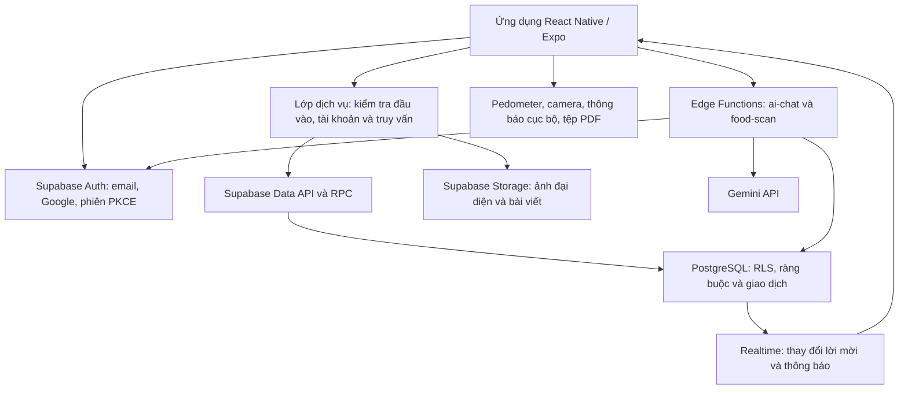

# HealthyCheck — Ứng dụng theo dõi sức khỏe cá nhân

Đồ án môn **Lập trình thiết bị di động**, Trường **Đại học Công nghiệp Thành phố Hồ Chí Minh (IUH)**.

| Thông tin | Nội dung |
|---|---|
| Tên đề tài | Ứng dụng theo dõi sức khỏe cá nhân HealthyCheck |
| Giảng viên hướng dẫn | TS. Nguyễn Minh Hải |
| Lớp | DHKTPM19B |
| Nhóm | 25 |
| Phiên bản ứng dụng | 1.0.0 |
| Nền tảng ưu tiên để trình diễn | Android, bản cài đặt APK |
| Mã nguồn | [TanJuniorr/HealthyCheck](https://github.com/TanJuniorr/HealthyCheck) |

## Mục lục

1. [Giới thiệu dự án](#1-giới-thiệu-dự-án)
2. [Công nghệ sử dụng](#2-công-nghệ-sử-dụng)
3. [Các chức năng chính](#3-các-chức-năng-chính)
4. [Kiến trúc hệ thống](#4-kiến-trúc-hệ-thống)
5. [Cấu trúc thư mục](#5-cấu-trúc-thư-mục)
6. [Cài đặt và chạy ứng dụng](#6-cài-đặt-và-chạy-ứng-dụng)
7. [Cơ sở dữ liệu và cấu hình Supabase](#7-cơ-sở-dữ-liệu-và-cấu-hình-supabase)
8. [Build APK Android](#8-build-apk-android)
9. [Kiểm thử](#9-kiểm-thử)
10. [Giới hạn và hướng phát triển](#10-giới-hạn-và-hướng-phát-triển)
11. [Thông tin nhóm, liên kết và giấy phép](#11-thông-tin-nhóm-liên-kết-và-giấy-phép)

## 1. Giới thiệu dự án

HealthyCheck giúp người dùng tập hợp nhật ký vận động, ăn uống, giấc ngủ, nước uống, cân nặng và chu kỳ kinh nguyệt trong một ứng dụng. Thay vì ghi chép phân tán, người dùng có thể xem dữ liệu theo ngày, theo dõi biểu đồ, điều chỉnh mục tiêu và xuất báo cáo để xem lại thói quen của mình.

Ứng dụng hướng đến người dùng cá nhân muốn xây dựng thói quen sinh hoạt và theo dõi tiến độ, đặc biệt là người dùng trưởng thành phù hợp với phạm vi của các bộ tính mục tiêu. Chức năng đọc bài viết và Healthy AI hỗ trợ tìm hiểu thông tin sức khỏe; chia sẻ riêng tư cho phép một tài khoản cụ thể xem các chỉ số được chủ dữ liệu cho phép.

Sản phẩm được phát triển phục vụ học tập và trình diễn đồ án. Các chỉ số tính toán, điểm tổng hợp, dự đoán chu kỳ và kết quả AI là thông tin tham khảo; ứng dụng không phải thiết bị hay phần mềm y tế được chứng nhận, không chẩn đoán, kê đơn hoặc thay thế chuyên gia y tế. Các chức năng cảm biến, thông báo và camera phụ thuộc thiết bị, quyền hệ điều hành và dịch vụ bên ngoài.

## 2. Công nghệ sử dụng

Các phiên bản dưới đây phản ánh khai báo trong [package.json](HealthyCheck/package.json); phiên bản cài đặt cụ thể được khóa trong [package-lock.json](HealthyCheck/package-lock.json).

| Thành phần | Công nghệ thực tế | Vai trò |
|---|---|---|
| Ứng dụng | React Native 0.88.1, React 19.3.0, Expo SDK 58 | Giao diện và chức năng thiết bị; cấu hình native qua Expo |
| Ngôn ngữ | TypeScript `~6.0.3` | Kiểu dữ liệu, kiểm tra mã nguồn |
| Điều hướng | Expo Router `~58.0.28` | Điều hướng theo tệp trong `app/`, bảo vệ màn hình theo trạng thái đăng nhập và vai trò |
| Giao diện web | React Native Web, React DOM, Metro | Chạy và kiểm tra giao diện trên trình duyệt |
| Xác thực và truy cập dữ liệu | Supabase JS `^2.118.0` | Email/mật khẩu, Google OAuth, phiên đăng nhập, truy vấn, RPC và Realtime |
| Dữ liệu phía máy chủ | Supabase PostgreSQL, RLS | Nhật ký, mục tiêu, bài viết, lời mời và phân quyền từng hàng |
| Tệp và ảnh | Supabase Storage | Ảnh đại diện, ảnh bài viết và URL truy cập ảnh |
| Xử lý phía máy chủ | Supabase Edge Functions, TypeScript trên Deno | Xác thực yêu cầu AI, gọi Gemini và hỗ trợ nhập ảnh bài viết |
| AI | Gemini API; mã nguồn hai hàm AI khai báo `gemini-3.5-flash-lite` | Hội thoại sức khỏe và ước tính món ăn từ ảnh |
| Lưu trữ trên thiết bị | AsyncStorage; `expo-sqlite/localStorage` để tương thích dữ liệu phiên cũ | Phiên đăng nhập, tùy chọn giao diện/ngôn ngữ/thông báo và bộ nhớ đệm |
| Chức năng thiết bị | `expo-sensors`, `expo-camera`, `expo-image-picker`, `expo-notifications` | Bước chân, chụp/chọn ảnh và thông báo cục bộ |
| Báo cáo | `expo-print`, `expo-file-system`, `expo-sharing` | Tạo, mở, in và chia sẻ báo cáo PDF trên thiết bị |
| Giao diện và biểu đồ | `react-native-svg`, Expo Vector Icons, Safe Area Context, DateTimePicker | Biểu đồ, biểu tượng, vùng an toàn và chọn thời gian |
| Đa ngôn ngữ | i18next, react-i18next, `expo-localization` | Tiếng Việt/tiếng Anh và định dạng dữ liệu |
| Kiểm thử | Bộ chạy `node:test`, PGlite, TypeScript, ESLint | Kiểm thử tính toán, dịch vụ, tương tác giao diện và SQL |
| Đóng gói | EAS CLI / EAS Build | Cấu hình và build ứng dụng trên dịch vụ Expo |

Nguồn danh mục thực phẩm được lưu cùng dữ liệu nguồn USDA trong `supabase/seeds/`; ảnh nguyên liệu minh họa được lấy từ TheMealDB khi có đối sánh phù hợp. Giá trị dinh dưỡng và ảnh minh họa là hai nguồn độc lập.

## 3. Các chức năng chính

“Đã hiện thực” trong bảng dưới đây có nghĩa là có màn hình và luồng xử lý tương ứng trong mã nguồn. Điều đó không đồng nghĩa mọi dịch vụ bên ngoài đã được cấu hình hoặc mọi luồng đã được kiểm thử trên điện thoại thật.

| STT | Nhóm chức năng | Nội dung đã hiện thực | Điều kiện và phạm vi |
|---|---|---|---|
| 1 | Đăng ký, đăng nhập | Đăng ký email/mật khẩu, đăng nhập email và Google, đăng xuất, quên và đặt lại mật khẩu qua liên kết xác thực PKCE | Google cần cấu hình OAuth; xác nhận email và gửi email khôi phục phụ thuộc Supabase Auth/SMTP |
| 2 | Hồ sơ sức khỏe và onboarding | Nhập ngày sinh, giới tính, chiều cao, cân nặng, cường độ vận động và mục tiêu cân nặng; sửa hồ sơ, ảnh đại diện | Tài khoản mới phải hoàn tất hồ sơ trước khi vào các màn hình chính; lưu qua RPC theo tài khoản |
| 3 | Mục tiêu cá nhân | Tính đề xuất calo, bước chân và nước uống; phân biệt đề xuất, mục tiêu đã lưu và dữ liệu đã ghi nhận; cho phép chỉnh thủ công | Bước chân/calo phù hợp được tự lưu khi hoàn tất onboarding; nước uống cần xác nhận riêng trước khi áp dụng |
| 4 | Theo dõi bước chân | Đăng ký cảm biến Pedometer, xin quyền, cộng số bước của phiên vào nhật ký ngày, xem lịch sử và biểu đồ | Cần thiết bị hỗ trợ; không bảo đảm ghi đủ ngày khi ứng dụng đóng hoặc ở nền |
| 5 | Giấc ngủ và lịch ngủ | Thêm/sửa/xóa phiên ngủ, thời điểm bắt đầu/kết thúc, đánh giá chất lượng, thống kê và lịch nhắc theo ngày trong tuần | Giấc ngủ do người dùng nhập, không được đo tự động bằng cảm biến |
| 6 | Nước uống | Ghi lượng nước theo ml, sửa/xóa lịch sử, chọn ngày, xem tổng lượng nước và tiến độ | Là dữ liệu người dùng ghi nhận, không phải lượng nước được cảm biến đo |
| 7 | Dinh dưỡng và bữa ăn | Tìm thực phẩm theo tên Việt/Anh, lọc 8 nhóm, phân trang, nhập gram hoặc đơn vị có quy đổi, chọn nhiều món, sửa/xóa bữa ăn, tổng hợp kcal và các chất đa lượng | Phân biệt bữa sáng/trưa/tối/ăn nhẹ; dinh dưỡng tính từ khẩu phần và dữ liệu trên 100 g |
| 8 | Cân nặng và BMI | Ghi cân nặng, xem xu hướng, tính BMI từ chiều cao và cân nặng đã lưu | Người dùng nhập cân nặng; không có tích hợp cân thông minh |
| 9 | Chu kỳ kinh nguyệt | Quản lý kỳ kinh đã xác nhận, lịch tháng, nhật ký lượng kinh/tâm trạng/triệu chứng, dự đoán và nhắc kỳ tiếp theo | Màn hình hiện dành cho hồ sơ có giới tính `female`; tách ngày thực tế khỏi dự đoán, không dùng cho tránh thai |
| 10 | Healthy AI Chat | Gửi câu hỏi, lưu/mở/xóa cuộc hội thoại, dùng bản tổng hợp dữ liệu sức khỏe gần đây làm ngữ cảnh | Cần triển khai `ai-chat`, khóa Gemini hợp lệ, mạng và hạn mức; không cung cấp chẩn đoán |
| 11 | Quét ảnh món ăn bằng AI | Chụp/chọn ảnh, nhận diện tối đa 6 món, đề xuất khẩu phần và dinh dưỡng; cho chọn/điều chỉnh, ghép với thực phẩm hoặc tạo món ước tính riêng rồi ghi bữa ăn | Cần `food-scan`, camera/thư viện ảnh và quyền tương ứng; kết quả là ước tính từ ảnh |
| 12 | Khám phá bài viết | Danh sách mới/nổi bật/đề xuất, tìm kiếm/lọc, đọc nội dung, lưu bài, lịch sử đọc và chọn chủ đề quan tâm | Bài đã xuất bản được đọc qua cơ sở dữ liệu; đề xuất bài dựa trên các quy tắc/dữ liệu trong hệ thống |
| 13 | Quản trị bài viết | Quản lý bài viết và danh mục ngay trong app, nội dung Việt/Anh, soạn Markdown/xem trước, ảnh bìa/ảnh trong bài, bản nháp, xuất bản, lưu trữ và xóa | Cần vai trò `admin` do máy chủ cấp; có lưu nháp tự động và kiểm tra xung đột phiên bản |
| 14 | Chia sẻ riêng tư | Mời bằng email một tài khoản đã xác nhận, chọn bước chân/giấc ngủ/dinh dưỡng; chấp nhận/từ chối, tạm dừng/tiếp tục, sửa phạm vi và thu hồi | Chỉ người nhận cụ thể và lời mời đang có hiệu lực được đọc dữ liệu cho phép; không có nhóm gia đình hoặc cộng đồng |
| 15 | Thông báo và nhắc nhở | Hộp thư thông báo trong app, đánh dấu đã đọc; thông báo lời mời, đạt mục tiêu bước chân, điểm tổng hợp thấp; lịch nhắc sinh hoạt/ngủ/chu kỳ | Thông báo thiết bị dùng Expo Notifications cục bộ; không có hệ thống push máy chủ định kỳ hoàn chỉnh |
| 16 | Báo cáo sức khỏe PDF | Chọn khoảng ngày tối đa 90 ngày, tổng hợp bước chân/ngủ/nước/dinh dưỡng/cân nặng và mục tiêu, tạo báo cáo có biểu đồ | Native có tạo/mở/chia sẻ/in PDF; web mở bản xem trước và hộp thoại in, không xác nhận được người dùng đã lưu tệp |
| 17 | Ngôn ngữ và giao diện | Chuyển tiếng Việt/Anh, chế độ sáng/tối, lưu lựa chọn trên thiết bị | Mức hỗ trợ của từng chức năng native và web khác nhau |

### 3.1. Cách cá nhân hóa mục tiêu

- **Calo:** dùng bộ tính Mifflin–St Jeor, hệ số hoạt động và mục tiêu cân nặng. Bộ tính kiểm tra dữ liệu thiếu, phạm vi tuổi và các trường hợp cần xem xét; không thay số liệu thiếu bằng 2.000 kcal. Hồ sơ thiếu hệ số cần thiết, chẳng hạn giới tính không thuộc hai hệ số công thức hiện có, có thể chưa nhận được đề xuất calo.
- **Bước chân:** tài khoản mới dùng mức bắt đầu theo cường độ vận động và nhóm tuổi. Việc tăng mục tiêu theo lịch sử chỉ sử dụng ngày có độ bao phủ và nguồn thu thập đủ điều kiện; các bản ghi cũ không tự được xem là dữ liệu đầy đủ cả ngày.
- **Nước uống:** ước tính lượng dịch uống dựa trên cân nặng và mức vận động, có điều kiện giới hạn. Đây không phải phép đo tổng nước từ thức ăn/đồ uống và không tự chứng minh nhu cầu y tế cá nhân. Người dùng phải xác nhận riêng khi áp dụng vào mục tiêu theo dõi nước.
- **Lưu mục tiêu:** onboarding lưu hồ sơ, cân nặng và mục tiêu ban đầu trong một giao dịch. Bước chân/calo không có đề xuất phù hợp được để chưa đặt. Sau đó, thay đổi mục tiêu tạo bản ghi theo thời điểm hiệu lực, giữ lịch sử để tổng hợp báo cáo.

Luồng khởi tạo hiện vẫn dùng 2.000 ml nước và 480 phút ngủ nếu chưa có giá trị tương ứng trước đó; đó là giá trị khởi tạo, không phải kết quả cá nhân hóa nước/ngủ. Việc sửa hồ sơ về sau không tự ghi đè mục tiêu đã lưu; người dùng có thể xem lại đề xuất và chủ động áp dụng.

## 4. Kiến trúc hệ thống



### 4.1. Phân lớp trong ứng dụng

- `app/`: các màn hình và điều hướng bằng Expo Router.
- `src/components/`: thành phần giao diện dùng lại, biểu mẫu, biểu đồ và trình soạn bài.
- `src/contexts/`: phiên đăng nhập, vai trò quản trị, giao diện, cảm biến và lịch nhắc.
- `src/hooks/`: tải dữ liệu theo màn hình, phân trang và làm mới theo sự kiện.
- `src/services/`: giao tiếp Auth, bảng dữ liệu, RPC, Storage, Edge Functions và API thiết bị.
- `src/lib/`: kiểm tra dữ liệu, công thức, xử lý ngày, logic mục tiêu, báo cáo và quyền chia sẻ.

Ứng dụng không có máy chủ Express/Node riêng. PostgreSQL là nơi lưu trữ dữ liệu nghiệp vụ; bộ nhớ cục bộ chủ yếu phục vụ phiên đăng nhập và tùy chọn, chưa phải cơ chế đồng bộ nhật ký ngoại tuyến đầy đủ.

### 4.2. Xác thực và phân quyền

App sử dụng publishable key và phiên người dùng để gọi Supabase. Các dịch vụ kiểm tra tài khoản, gắn chủ sở hữu khi ghi và loại kết quả trả về sau khi đổi tài khoản. **RLS** tiếp tục kiểm soát quyền truy cập tại database; việc ẩn màn hình trong giao diện không thay thế RLS.

Quyền admin lấy từ `user_roles` do máy chủ quản lý. Chia sẻ dữ liệu qua các RPC kiểm tra đúng người nhận, trạng thái, phiên bản và phạm vi lời mời. Realtime của luồng chia sẻ báo thay đổi thông tin lời mời/thông báo để app tải lại; không phát toàn bộ bản ghi sức khỏe thô của tài khoản khác.

### 4.3. Luồng AI và dữ liệu gửi ra ngoài

App gửi JWT cùng câu hỏi hoặc ảnh đến Edge Function. Hàm xác thực người dùng bằng Supabase Auth, xử lý dữ liệu trong phạm vi tài khoản, rồi gọi Gemini bằng khóa phía máy chủ. Cả `ai-chat` và `food-scan` hiện dùng publishable/anon key cùng JWT người dùng cho các thao tác dữ liệu, không dùng service-role để đọc nhật ký vượt RLS.

Màn hình chat hiện gửi `includeHealthData: true`. Edge Function tổng hợp bước chân, giấc ngủ, bữa ăn và nước uống của 7 ngày gần đây để gửi kèm câu hỏi; dữ liệu tổng hợp không chủ động thêm email hay mã tài khoản. Nội dung người dùng tự nhập vẫn có thể chứa thông tin cá nhân. Lịch sử hội thoại được lưu trong `ai_chat_conversations`. UI hiện chưa có công tắc riêng để tắt ngữ cảnh sức khỏe cho mỗi câu hỏi.

Ảnh quét món ăn được chuyển tới Gemini để phân tích; luồng `food-scan` không ghi ảnh vào Storage. Những món người dùng xác nhận lưu mới được ghi vào danh mục riêng/nhật ký. Không nhúng khóa Gemini, secret key hoặc service-role key vào mã nguồn mobile hay biến `EXPO_PUBLIC_*`.

## 5. Cấu trúc thư mục

Thư mục gốc repository và thư mục ứng dụng là hai cấp khác nhau. Các lệnh npm/Expo/EAS trong tài liệu được chạy tại **`HealthyCheck/HealthyCheck` sau khi clone**.

```text
HealthyCheck/                         # Gốc repository GitHub
├── README.md
├── LICENSE
├── AGENTS.md
├── .gitignore
└── HealthyCheck/                     # Thư mục ứng dụng, chứa package.json
    ├── app/
    │   ├── _layout.tsx              # Provider và cổng điều hướng theo phiên
    │   ├── (tabs)/                  # Tổng quan, khám phá, quét ảnh, AI, chia sẻ
    │   ├── auth/                    # Callback và kiểm tra hồ sơ
    │   ├── health/                  # Chỉ số sức khỏe, nhật ký và báo cáo
    │   ├── meals/                   # Ghi/sửa bữa ăn
    │   ├── article/                 # Đọc, lưu bài, lịch sử, sở thích
    │   ├── admin/                   # Quản lý danh mục, bài viết, trình soạn
    │   ├── notifications/           # Hộp thư và chi tiết thông báo
    │   ├── login.tsx
    │   ├── signup.tsx
    │   ├── health-onboarding.tsx
    │   ├── profile.tsx
    │   └── settings.tsx
    ├── src/
    │   ├── components/              # Giao diện dùng lại theo nhóm chức năng
    │   ├── constants/               # Màu sắc, chữ, khoảng cách
    │   ├── contexts/                # Trạng thái dùng chung
    │   ├── hooks/                   # Truy vấn và sự kiện làm mới
    │   ├── services/                # Dịch vụ dữ liệu và thiết bị
    │   ├── lib/                     # Logic nghiệp vụ và tính toán
    │   ├── types/                   # Kiểu dữ liệu ứng dụng/database
    │   ├── i18n/resources/          # vi.json và en.json
    │   └── data/                    # Nội dung tĩnh và dữ liệu mẫu còn lưu lại
    ├── supabase/
    │   ├── config.toml
    │   ├── migrations/              # SQL nâng cấp schema, chính sách và dữ liệu
    │   ├── functions/
    │   │   ├── ai-chat/
    │   │   ├── food-scan/
    │   │   └── import-article-covers/
    │   ├── seeds/                   # Danh mục thực phẩm, bài viết, ảnh và nguồn
    │   └── tests/                   # Fixture/kiểm tra RLS chia sẻ riêng
    ├── scripts/                     # Kiểm thử database, chuẩn bị/nhập dữ liệu
    ├── tests/                       # Kiểm thử ứng dụng với node:test
    ├── docs/                        # Tài liệu chức năng, hiện có theo dõi chu kỳ
    ├── assets/                      # Biểu tượng và tài nguyên ứng dụng
    ├── .env.example
    ├── app.json
    ├── eas.json
    ├── package.json
    ├── package-lock.json
    ├── tsconfig.json
    ├── eslint.config.js
    └── index.ts                     # Nạp expo-router/entry
```

Cây trên thể hiện các nhánh chính, không liệt kê toàn bộ màn hình/tệp. Đường dẫn route thực tế là `HealthyCheck/app/`, không phải `src/app/`. Các tệp mẫu còn trong `src/data/` không chứng minh chỉ số đang hiển thị là dữ liệu đo được; các màn hình nhật ký chính lấy dữ liệu qua lớp dịch vụ.

## 6. Cài đặt và chạy ứng dụng

### 6.1. Yêu cầu môi trường

- Git, Node.js và npm. Nên dùng **Node.js 24 LTS từ 24.3.0**; nhánh Node.js 22 cần từ 22.13.0 để phù hợp yêu cầu của các gói Expo/React Native hiện tại. Môi trường kiểm tra tài liệu dùng Node.js 24.13.0 và npm 11.6.2.
- Điện thoại Android hoặc Android Emulator. Nếu dùng emulator/ADB, cài Android Studio và bộ công cụ Android tương ứng.
- Tài khoản Supabase hoặc thông tin kết nối đến backend demo đã chuẩn bị; cần mạng cho truy vấn và AI.
- Tài khoản Expo có quyền với dự án EAS khi tạo development build hoặc APK bằng dịch vụ cloud.
- Không cần Docker/PostgreSQL riêng để chạy app với Supabase từ xa hoặc chạy bộ kiểm thử PGlite. Cấu hình Supabase cục bộ đầy đủ là quy trình riêng.

### 6.2. Tải mã nguồn và cài thư viện

```sh
git clone https://github.com/TanJuniorr/HealthyCheck.git
cd HealthyCheck/HealthyCheck
npm ci
```

`npm ci` sử dụng phiên bản khóa sẵn trong `package-lock.json`. Khi cần bổ sung thư viện Expo trong quá trình phát triển, dùng `npx expo install <ten-goi>` để chọn phiên bản phù hợp SDK, không tự thay hàng loạt phiên bản khi chỉ cài để chấm/demo.

### 6.3. Tạo cấu hình môi trường

PowerShell:

```powershell
Copy-Item .env.example .env
```

macOS/Linux:

```sh
cp .env.example .env
```

Điền thông tin của dự án Supabase được phép sử dụng:

```dotenv
EXPO_PUBLIC_SUPABASE_URL=https://YOUR_PROJECT_REF.supabase.co
EXPO_PUBLIC_SUPABASE_PUBLISHABLE_KEY=YOUR_PUBLISHABLE_KEY
```

Lấy URL và publishable key từ phần kết nối/API của Supabase Dashboard. Hai biến này được đóng gói trong ứng dụng; publishable key không phải khóa quản trị, quyền dữ liệu phải được bảo vệ bằng RLS. Không đưa `GEMINI_API_KEY`, `sb_secret_*` hoặc service-role key vào `.env` của mobile. `.env` đã được loại khỏi Git bằng `.gitignore`.

Backend phải có các bảng, RPC, chính sách và bucket cần thiết trước khi đăng ký/ghi nhật ký. Nếu dùng dự án Supabase mới hoàn toàn, đọc [mục 7](#7-cơ-sở-dữ-liệu-và-cấu-hình-supabase) trước; chỉ điền hai biến môi trường chưa đủ để khởi tạo backend.

### 6.4. Khởi chạy Expo

| Lệnh | Hành vi thực tế |
|---|---|
| `npm start` | Chạy `expo start`, mở máy chủ Metro |
| `npm run android` | Chạy `expo start --android`, yêu cầu mở ứng dụng Android tương thích đã cài |
| `npm run ios` | Chạy `expo start --ios`; môi trường simulator iOS cần macOS phù hợp |
| `npx expo start --web` | Chạy web cục bộ để kiểm tra giao diện; không phải bản triển khai chính |
| `npx expo start --dev-client` | Chạy Metro cho development build đã cài trên thiết bị |

Quy trình ưu tiên để kiểm tra đầy đủ trên Android:

1. Chuẩn bị development build theo profile `development` ở mục 8 và cài lên máy.
2. Chạy `npx expo start --dev-client` trong thư mục ứng dụng.
3. Mở development build trên điện thoại, kết nối máy tính và điện thoại cùng mạng hoặc dùng kết nối phù hợp của Expo. Với emulator, khởi động máy ảo trước rồi dùng `npm run android`.
4. Đăng ký/đăng nhập, hoàn tất onboarding và cấp những quyền cần cho chức năng đang thử.

Có thể thử các màn hình tương thích bằng `npx expo start --go` nếu phiên bản Expo Go hỗ trợ SDK 58 và các module cần dùng. Expo Go chỉ có các module native được đóng gói sẵn; không dùng kết quả thử trên Expo Go/web để khẳng định cảm biến, callback Google, thông báo và PDF đã hoạt động đầy đủ trên bản APK. Xem [hướng dẫn môi trường Expo](https://docs.expo.dev/get-started/set-up-your-environment/).

Sau khi đổi biến `EXPO_PUBLIC_*`, khởi động lại Metro; có thể dùng `npx expo start --clear` khi cần xóa bộ nhớ đệm. APK đã build cần được build lại để nhận thay đổi các biến được đóng gói.

## 7. Cơ sở dữ liệu và cấu hình Supabase

### 7.1. Các nhóm bảng chính

| Bảng/nhóm bảng | Vai trò |
|---|---|
| `auth.users` | Tài khoản do Supabase Auth quản lý |
| `profiles` | Hồ sơ cá nhân, thông tin sức khỏe, tùy chọn hoạt động/mục tiêu cân nặng và dấu hoàn tất onboarding |
| `health_goals` | Lịch sử mục tiêu bước chân, calo, nước và thời lượng ngủ theo ngày hiệu lực |
| `step_records` | Nhật ký bước chân theo ngày |
| `sleep_records`, `sleep_schedules` | Phiên ngủ đã ghi và lịch ngủ/nhắc theo ngày trong tuần |
| `water_records`, `weight_records` | Nhật ký nước uống và cân nặng |
| `foods`, `meal_records` | Danh mục dinh dưỡng, món ước tính riêng theo tài khoản và các món đã ghi trong bữa ăn |
| `menstrual_cycle_settings`, `menstrual_cycle_periods`, `menstrual_cycle_logs` | Cài đặt, kỳ kinh đã xác nhận và nhật ký từng ngày |
| `ai_chat_conversations` | Hội thoại và tin nhắn Healthy AI của từng người dùng |
| `sharing_invites` | Chủ dữ liệu, người nhận cụ thể, phạm vi cho phép, trạng thái và phiên bản lời mời |
| `app_notifications` | Hộp thư thông báo và thời điểm đã đọc |
| `user_roles` | Vai trò người dùng/admin được quản lý phía máy chủ |
| `article_categories`, `articles`, `article_translations` | Danh mục và nội dung bài viết đa ngôn ngữ |
| `article_bookmarks`, `article_read_history`, `article_category_preferences` | Bài đã lưu, lịch sử đọc và chủ đề quan tâm |
| `private.article_admin_invites` | Lời mời cấp vai trò admin được gắn với tài khoản xác nhận; không phải bảng công khai của app |

Ảnh lưu qua Storage với các bucket `avatars` và `article-images`; quyền trên `storage.objects` cần tương ứng với nghiệp vụ. Tùy chọn giao diện/ngôn ngữ và bật/tắt thông báo được lưu trên thiết bị, không phải mỗi tùy chọn đều có một bảng PostgreSQL riêng.

### 7.2. Trạng thái migration và điều kiện tái tạo backend

**Repository hiện chưa cung cấp bộ khởi tạo hoàn chỉnh cho một Supabase rỗng.** Cần phân biệt hai trường hợp:

- **Chạy/chấm với backend đã chuẩn bị:** xin URL, publishable key và tài khoản demo thích hợp từ nhóm; không chạy lại toàn bộ SQL lên database đang dùng.
- **Tự tạo backend mới:** người quản trị cần bổ sung/khôi phục schema nền từ bản sao được phép sử dụng, sau đó đối chiếu và áp dụng các migration nâng cấp. Nếu chưa có schema nền, cần liên hệ nhóm trước khi tiếp tục.

Các điểm cần kiểm tra từ mã nguồn hiện tại:

1. Chưa có migration tạo đầy đủ các bảng nền `profiles`, `health_goals`, `step_records`, `sleep_records`, `water_records`, `weight_records`, `sleep_schedules`, bucket `avatars` và toàn bộ thiết lập nền liên quan. Nhiều migration bắt đầu bằng `ALTER TABLE` hoặc sử dụng những đối tượng này.
2. Hàm `handle_new_user()` được thay thế ở migration mới, nhưng cần có trigger nền trên `auth.users` để gọi hàm. Bảng `health_goals` nền còn phải tương thích với ràng buộc được migration snapshot loại bỏ.
3. Có migration cũ mang tiền tố ngày 8 chữ số và trùng tiền tố, bên cạnh các migration thời gian 14 chữ số. Phải đối chiếu phụ thuộc và lịch sử đã áp dụng, không dựa hoàn toàn vào thứ tự tên tệp hoặc tự sửa lịch sử trên database đang hoạt động.
4. `supabase/config.toml` còn `project_id = "frontend"` là nhãn CLI cũ, không phải cấu trúc thư mục hiện tại. Cấu hình seed trỏ tới `./seed.sql`, nhưng repository không có tệp đó; dữ liệu nguồn thực tế nằm trong `supabase/seeds/` và một số migration đã chứa SQL nhập dữ liệu.

Vì những điều kiện trên, không coi `supabase db reset` hoặc chạy toàn bộ migration trên database mới là quy trình một lệnh đã được xác minh. Các fixture tự tạo schema tối thiểu trong `scripts/test-*.cjs` phục vụ kiểm thử, không phải script cài backend sản phẩm.

### 7.3. Quy trình cấu hình backend

Thực hiện từ thư mục chứa `supabase/`. Cần quyền quản trị đúng dự án; chuỗi `YOUR_PROJECT_REF` là giá trị thay thế, không phải dự án thật.

```sh
npx supabase@latest login
npx supabase@latest link --project-ref YOUR_PROJECT_REF
npx supabase@latest migration list --remote
npx supabase@latest db push --remote --dry-run
```

Các cờ `--remote` ở đây theo CLI được đối chiếu khi viết tài liệu; kiểm tra lại `--help` nếu máy đang dùng CLI khác. `--dry-run` chỉ xem kế hoạch, không chứng minh SQL có thể chạy thành công khi schema nền còn thiếu.

Sau khi đã sao lưu, chuẩn bị schema nền và đối chiếu đầy đủ lịch sử migration trên dự án thử nghiệm, người quản trị mới áp dụng những migration còn thiếu. Với CLI tương ứng, lệnh áp dụng là `npx supabase@latest db push --remote`; không chạy mù lệnh này lên database demo/production hiện có, không tự thêm `--include-all` để bỏ qua chênh lệch lịch sử.

Các bước hoàn thiện dịch vụ:

1. Đối chiếu bảng/cột và RPC với `src/types/database.ts`, `src/services/queryCore.ts` cùng các migration. Bật RLS và chính sách chủ sở hữu cho dữ liệu cá nhân; cấp quyền Data API phù hợp.
2. Thiết lập bucket `avatars` với chính sách đường dẫn theo tài khoản. Kiểm tra bucket `article-images` và các chính sách đọc/ghi/bảo vệ ảnh đang được tham chiếu từ migration bài viết. Không mở quyền ghi công khai để xử lý lỗi Storage.
3. Kiểm tra publication Realtime cho `sharing_invites` và `app_notifications`. Giữ các schema nội bộ `private`, `sharing_private` ngoài danh sách schema công khai của Data API.
4. Bật xác thực email; cấu hình gửi email/SMTP và URL chuyển hướng cho xác nhận/khôi phục theo môi trường demo.
5. Cấu hình Google OAuth như mục 7.4, triển khai các hàm AI như mục 7.5.
6. Chuẩn bị tài khoản thường và tài khoản admin; kiểm tra onboarding, quyền nhật ký, bài viết và chia sẻ bằng ít nhất hai tài khoản đã xác nhận.

Danh mục thực phẩm và bài viết có dữ liệu nguồn trong `supabase/seeds/`. Các script Python trong `scripts/` hỗ trợ tái tạo SQL, chuẩn bị/nhập ảnh; không phải bước bắt buộc khi backend demo đã có dữ liệu. Không chạy lại seed/import để ghi đè nội dung đang sử dụng khi chưa xem cách script bảo toàn dữ liệu.

### 7.4. Google OAuth và tài khoản admin

Luồng Google dùng trình duyệt và callback PKCE, không có thông tin Google client secret trong ứng dụng. Người cấu hình cần:

1. Tạo OAuth client trên Google Cloud và khai báo callback do Supabase Dashboard cung cấp tại Google.
2. Bật nhà cung cấp Google trong Supabase Auth và nhập thông tin OAuth ở phía dịch vụ.
3. Thêm URL chuyển hướng của app vào danh sách cho phép của Supabase. Bản native dùng scheme `healthycheck` với callback `healthycheck://auth/callback`; web dùng `<origin>/auth/callback`, chẳng hạn `http://localhost:8081/auth/callback` nếu Metro thực tế chạy cổng 8081.
4. Thử lại trên development build/APK sau khi đổi cấu hình; URL trên Expo Go có thể khác custom scheme của bản build.

Xem [hướng dẫn Google của Supabase](https://supabase.com/docs/guides/auth/social-sign-in/auth-google). Với mật khẩu, code khôi phục cũng dùng route callback nói trên; dịch vụ gửi email cần được cấu hình riêng.

Admin mở các công cụ quản lý từ phần Khám phá trong app. Vai trò phải được cấp phía server trong `public.user_roles` cho đúng UUID tài khoản; client không được tự cấp vai trò qua email hay `user_metadata`. Migration bài viết có sẵn lời mời admin theo một email được định trước, nên người quản trị cần rà soát khi dựng môi trường mới; không giả định tài khoản vừa đăng ký nào cũng là admin. Không cần một website admin riêng.

### 7.5. Triển khai Edge Functions và secrets

Sau khi đã liên kết đúng Supabase project, đặt khóa Gemini ở mục secrets của Edge Functions trên Dashboard hoặc qua CLI:

```sh
npx supabase@latest secrets set GEMINI_API_KEY="YOUR_GEMINI_API_KEY"
npx supabase@latest functions deploy ai-chat --no-verify-jwt
npx supabase@latest functions deploy food-scan --no-verify-jwt
```

Lệnh trên là hướng dẫn triển khai, không phải xác nhận rằng các hàm đã được deploy trong lần viết README. Khóa là giá trị thay thế; không lưu khóa thật vào repository.

Hai handler hiện tự đọc Bearer token và gọi `auth.getUser()` trước khi xử lý. Cờ `--no-verify-jwt` tắt kiểm tra JWT ở gateway để dùng cơ chế xác thực trong handler; **không có nghĩa là cho phép yêu cầu không đăng nhập**. Phải giữ kiểm tra này khi bảo trì hàm. Mô hình xác thực cần được đối chiếu với [tài liệu bảo vệ Edge Functions](https://supabase.com/docs/guides/functions/auth).

`SUPABASE_URL` và các khóa Supabase phù hợp được nền tảng cung cấp cho môi trường hàm; code ưu tiên `SUPABASE_PUBLISHABLE_KEYS`, dự phòng `SUPABASE_ANON_KEY`. Không cần đưa service-role key vào app. Xem [secrets của Edge Functions](https://supabase.com/docs/guides/functions/secrets).

Hàm `import-article-covers` là công cụ hỗ trợ quản trị nhập ảnh đã duyệt, có cơ chế token tác vụ, chủ sở hữu và hạn dùng riêng. Hàm này sử dụng khóa quản trị phía server; không cần deploy để sử dụng chat/quét ảnh và không đưa các secrets của tác vụ nhập ảnh vào mobile.

Nếu AI báo chưa cấu hình, lỗi quyền, hết hạn mức hoặc hết thời gian chờ, kiểm tra secrets, quyền sử dụng model `gemini-3.5-flash-lite`, cấu hình xác thực và logs của đúng hàm. Không coi kết quả kiểm thử mô phỏng là xác nhận Gemini đã trả lời thành công trên dịch vụ thật.

## 8. Build APK Android

### 8.1. Kiểm tra tài khoản và liên kết EAS

Chạy trong thư mục ứng dụng:

```sh
npx eas-cli@latest login
npx eas-cli@latest whoami
npx eas-cli@latest project:info
npx eas-cli@latest build:configure --platform android
```

Thông tin hiện khai báo trong `app.json`:

| Thuộc tính | Giá trị |
|---|---|
| Tên hiển thị | `Healthy Check` |
| Slug / chủ sở hữu Expo | `HealthyCheck` / `nhattan1104` |
| EAS project ID | `7a79b643-9ea6-4d95-969a-8c932041ed7a` |
| Android application ID | `com.nvtan107.HealthyCheck` |
| Scheme | `healthycheck` |

Project ID là định danh công khai, không cấp quyền truy cập. Nếu gặp `Entity Not Authorized`, kiểm tra `whoami` và quyền của tài khoản đối với project. Người tải source cần được cấp quyền dự án của nhóm hoặc chủ động liên kết sang dự án của mình; không khắc phục bằng cách đổi key Supabase.

Khi cần một dự án EAS độc lập để demo, sau khi lưu lại cấu hình cũ, người build có thể gỡ `extra.eas.projectId`, sửa `owner` cho đúng tài khoản rồi dùng `npx eas-cli@latest project:init --account YOUR_EXPO_ACCOUNT`. Liên kết dự án mới không tự chuyển lịch sử build, biến môi trường hay thông tin ký của dự án cũ.

### 8.2. Kiểm tra profile và biến môi trường

[eas.json hiện tại](HealthyCheck/eas.json) có:

| Profile | Cấu hình chính | Mục đích |
|---|---|---|
| `development` | `developmentClient: true`, `distribution: internal` | Bản phát triển để kết nối Metro |
| `preview` | `environment: preview`, `distribution: internal` | Bản phân phối nội bộ để trình diễn |
| `production` | `autoIncrement: true` | Bản phát hành; không nên mặc định coi là APK cài trực tiếp |

CLI yêu cầu phiên bản từ 27.2.0, nguồn phiên bản ứng dụng đặt là `remote`. **Chưa profile nào khai báo trực tiếp `android.buildType: "apk"`.** Theo [tài liệu Expo về APK](https://docs.expo.dev/build-reference/apk/), `distribution: internal` là một cách cấu hình APK; tuy nhiên README không kèm kết quả artifact của một build thực tế đã được tải và cài thử.

Để ràng buộc tường minh định dạng APK khi nộp đồ án, người build có thể bổ sung khối `android` vào **profile `build.preview`**, giữ các profile và cấu hình khác. Nội dung của riêng profile `preview` sau khi bổ sung:

```json
{
  "environment": "preview",
  "distribution": "internal",
  "android": {
    "buildType": "apk"
  }
}
```

Đây là cấu hình đề xuất để người build áp dụng; tài liệu này không tự thay đổi `eas.json`. Không thay toàn bộ tệp bằng riêng đoạn profile trên.

Trước khi build cloud, tạo hai biến `EXPO_PUBLIC_SUPABASE_URL` và `EXPO_PUBLIC_SUPABASE_PUBLISHABLE_KEY` trong môi trường **preview** của EAS project. `.env` cục bộ đã bị Git bỏ qua, không nên giả định máy build sẽ tự có các giá trị đó. Đây là biến public được đóng gói, không dùng chế độ secret dành cho khóa quản trị. Xem [biến môi trường EAS](https://docs.expo.dev/eas/environment-variables/).

### 8.3. Build, tải và cài đặt

Build bản demo sau khi hoàn thành các bước trên:

```sh
npx eas-cli@latest build --platform android --profile preview
```

Nếu cần development build thay vì bản demo độc lập:

```sh
npx eas-cli@latest build --platform android --profile development
```

Với môi trường development, cũng phải cung cấp hai biến Supabase tương ứng. Bản development cần Metro; bản preview hoàn tất có thể mở như ứng dụng độc lập.

Sau khi build thành công:

1. Mở URL chi tiết build do EAS CLI trả về, kiểm tra trạng thái thành công và loại tệp thực tế là `.apk`.
2. Tải APK từ trang build về điện thoại; cho phép cài từ nguồn đang sử dụng nếu Android yêu cầu, rồi cài và mở ứng dụng.
3. Hoặc tải về máy tính, kết nối điện thoại bật USB debugging và cài bằng ADB:

```sh
adb install -r ./HealthyCheck.apk
```

`HealthyCheck.apk` là tên minh họa cho tệp đã tải; dùng đường dẫn/tên tệp thật. Với emulator đã cấu hình, có thể chọn bản build để cài bằng `npx eas-cli@latest build:run --platform android`.

Không có URL tải APK cố định được công bố trong repository. Cần hoàn tất build thật và kiểm tra tệp trước khi bổ sung liên kết nộp bài. `build:configure` chạy thành công chỉ xác nhận bước cấu hình, chưa chứng minh build/cài đặt hoặc các chức năng thiết bị đã thành công.

## 9. Kiểm thử

### 9.1. Các lệnh có sẵn

Chạy từ thư mục chứa `package.json`:

```sh
npm test
npm run test:auth
npm run test:db
npm run typecheck
npm run lint
```

Hoặc chạy toàn bộ nhóm kiểm thử ứng dụng và database qua script:

```sh
npm run test:all
```

| Lệnh | Phạm vi |
|---|---|
| `npm test` | Tất cả `tests/*.test.cjs`: hàm tính toán, dữ liệu đầu vào, dịch vụ, giao diện và tương tác qua fixture |
| `npm run test:auth` | Nhóm kiểm thử xác thực trong `tests/auth.test.cjs`; cũng nằm trong `npm test` |
| `npm run test:db` | 5 tệp kiểm thử SQL dùng PostgreSQL/PGlite: onboarding, thực phẩm, bài viết, snapshot mục tiêu và chu kỳ |
| `npm run test:all` | Lần lượt chạy `npm test` và `npm run test:db`; không tự bao gồm lint/typecheck |
| `npm run typecheck` | `tsc --noEmit` |
| `npm run lint` | `expo lint` |

Các kiểm thử dịch vụ giả lập yêu cầu/phiên Supabase; kiểm thử tương tác dùng bộ điều khiển hook và các thành phần native giả lập. Nhóm `test:db` thực thi SQL và RLS trên fixture PGlite cục bộ, không ghi vào Supabase thật, không chứng minh mọi migration có thể dựng toàn bộ sản phẩm từ database rỗng.

Luồng chia sẻ còn có fixture SQL riêng cần PostgreSQL thử nghiệm và logical WAL, được mô tả trong [hướng dẫn kiểm tra RLS chia sẻ](HealthyCheck/supabase/tests/README-sharing.md). Fixture này không nằm trong script `test:db` và không được chạy vào database sản phẩm.

### 9.2. Kết quả đã xác nhận khi soạn README

Kiểm tra ngày **05/11/2026**, trên môi trường Node.js 24.13.0, npm 11.6.2:

| Kiểm tra thực tế | Kết quả |
|---|---|
| `npm test` | 320/320 bài kiểm tra qua |
| `npm run test:db` | 9/9 bài kiểm tra qua |
| `npm run typecheck` | Qua, mã thoát 0 |
| `npm run lint` | Qua, mã thoát 0 |

Không chạy một build APK mới, triển khai Edge Function, thao tác database từ xa hay kiểm thử đầu cuối trên thiết bị thật trong lần soạn tài liệu này. Kết quả tự động trên không được dùng thay cho biên bản thử Google OAuth, Gemini, cảm biến, thông báo và PDF trên bản cài Android.

### 9.3. Gợi ý kịch bản trình diễn

1. Đăng ký/đăng nhập, xác nhận email nếu được yêu cầu, hoàn tất onboarding; đối chiếu mục tiêu bước chân/calo với hồ sơ.
2. Ghi nước uống, giấc ngủ, cân nặng; thêm nhiều món vào bữa ăn rồi sửa/xóa một khẩu phần và xem tổng quan cập nhật.
3. Trên điện thoại có cảm biến, cấp quyền và đi bộ để kiểm tra số bước; phân biệt với các dữ liệu nhật ký nhập tay.
4. Dùng hồ sơ phù hợp để ghi kỳ kinh đã xảy ra, nhật ký ngày và xem dự đoán khác với dữ liệu thực tế.
5. Nếu đã cấu hình AI, gửi câu hỏi và quét một ảnh món ăn; kiểm tra/điều chỉnh kết quả trước khi lưu.
6. Dùng tài khoản admin để tạo bản nháp và xuất bản bài; dùng tài khoản thường để đọc, lưu và xem lịch sử.
7. Dùng hai tài khoản đã xác nhận để gửi/chấp nhận lời mời, kiểm tra đúng phạm vi rồi tạm dừng hoặc thu hồi.
8. Bật thông báo trên Android, kiểm tra lịch nhắc và tạo/mở báo cáo PDF; đổi tiếng Việt/Anh và chế độ sáng/tối.

## 10. Giới hạn và hướng phát triển

### 10.1. Giới hạn hiện tại

- **Khả năng dựng lại backend:** thiếu baseline/schema nền đầy đủ và có tên migration cũ cần đối chiếu; một số chức năng không thể hoạt động với dự án Supabase trắng chỉ bằng `npm ci`.
- **Thiết bị:** bộ đếm bước chân đang dùng `Pedometer.watchStepCount` cho phiên ứng dụng; chưa có cơ chế thu thập nền đầy đủ, tích hợp Health Connect/HealthKit hoặc thiết bị đeo. Xem [phạm vi Pedometer trong Expo SDK 58](https://docs.expo.dev/versions/v58.0.0/sdk/pedometer/).
- **Nguồn nhật ký:** ngủ, nước, cân nặng và khẩu phần ăn do người dùng nhập/xác nhận. Không trình bày các giá trị đó như phép đo cảm biến. Chức năng nhịp tim đã được loại bỏ.
- **Công thức và dự đoán:** chỉ áp dụng khi dữ liệu/phạm vi của bộ tính cho phép. Điểm sức khỏe là quy tắc tổng hợp của ứng dụng; dự đoán chu kỳ là heuristic, chưa được kiểm định lâm sàng.
- **Dịch vụ bên ngoài:** Google OAuth, SMTP, Gemini, Storage và Realtime cần cấu hình đúng. Ảnh minh họa phụ thuộc nguồn ngoài; không phải ảnh của chính khẩu phần người dùng đã ăn.
- **AI:** có thể nhận diện sai hoặc ước lượng sai khẩu phần/thành phần; model và hạn mức phụ thuộc dịch vụ. Chat hiện gửi kèm ngữ cảnh sức khỏe tổng hợp, cần làm rõ lựa chọn đồng ý trước khi mở rộng phát hành.
- **Thông báo:** chủ yếu là thông báo cục bộ được app đặt lịch/điều hòa lại khi có điều kiện; không có bảo đảm máy chủ gửi push khi app đã đóng. Một số lịch, đặc biệt chu kỳ, cần mở app để cập nhật sau thay đổi và cho chu kỳ tiếp theo.
- **Web và iOS:** có mã hỗ trợ nhưng không phải mục tiêu phát hành ưu tiên; web không có đầy đủ cảm biến/thông báo/chia sẻ PDF như native. Chưa thể suy ra chất lượng trên thiết bị thật từ việc giao diện web chạy được.
- **Mạng và quyền riêng tư:** chưa có hàng đợi đồng bộ nhật ký ngoại tuyến đầy đủ hoặc mã hóa đầu cuối cho toàn bộ dữ liệu. Chia sẻ trong app chỉ hỗ trợ lời mời tới tài khoản cụ thể và ba nhóm dữ liệu được chọn.
- **Tài liệu thiết lập:** liên kết EAS hiện thuộc tài khoản nhóm; người ngoài cần quyền hoặc dự án riêng. Chưa có APK/screenshot minh họa mới được xác nhận để gắn vào README.

### 10.2. Hướng phát triển

- Chuẩn hóa migration, bổ sung baseline, script khởi tạo và dữ liệu demo không chứa thông tin cá nhân để tái tạo môi trường từ đầu.
- Hoàn thiện profile APK tường minh, quy trình kiểm tra trước build và bộ kiểm thử đầu cuối trên Android thật.
- Bổ sung thu thập vận động qua nền tảng sức khỏe khi phù hợp, làm rõ nguồn/độ bao phủ dữ liệu từng ngày.
- Thiết kế lựa chọn đồng ý/tắt ngữ cảnh sức khỏe cho AI, kiểm soát hạn mức và tăng kiểm tra đầu ra món ăn.
- Cải thiện khả năng làm việc ngoại tuyến, đồng bộ có xử lý xung đột và khả năng truy cập giao diện.
- Mở rộng kiểm thử OAuth, quyền camera/thông báo, thay đổi múi giờ, tạo PDF và khôi phục sau mất mạng.

## 11. Thông tin nhóm, liên kết và giấy phép

**Nhóm 25 — DHKTPM19B**, Đại học Công nghiệp Thành phố Hồ Chí Minh (IUH). Giảng viên hướng dẫn: **TS. Nguyễn Minh Hải**.

| Họ và tên | MSSV |
|---|---|
| Lê Nhật Tân | 23668971 |
| Nguyễn Văn Tân | 23707391 |
| Hoàng Thành Long | 23731211 |

- [Repository GitHub](https://github.com/TanJuniorr/HealthyCheck)
- [Ứng dụng và cấu hình Expo](HealthyCheck/app.json)
- [Cấu hình build EAS](HealthyCheck/eas.json)
- [Tài liệu theo dõi chu kỳ](HealthyCheck/docs/cycle-tracking-upgrade.md)
- [Kiểm tra chia sẻ và RLS](HealthyCheck/supabase/tests/README-sharing.md)
- [Giấy phép hiện có](LICENSE)

Repository có tệp **MIT License**. Tệp hiện ghi bản quyền `2015-present 650 Industries, Inc. (aka Expo)` từ nền tảng/mẫu ban đầu; README giữ nguyên nội dung và thông báo bản quyền đó. Các dữ liệu nguồn, hình ảnh và dịch vụ bên ngoài có điều kiện sử dụng riêng; tham khảo thông tin nguồn trong các manifest/seed tương ứng.
